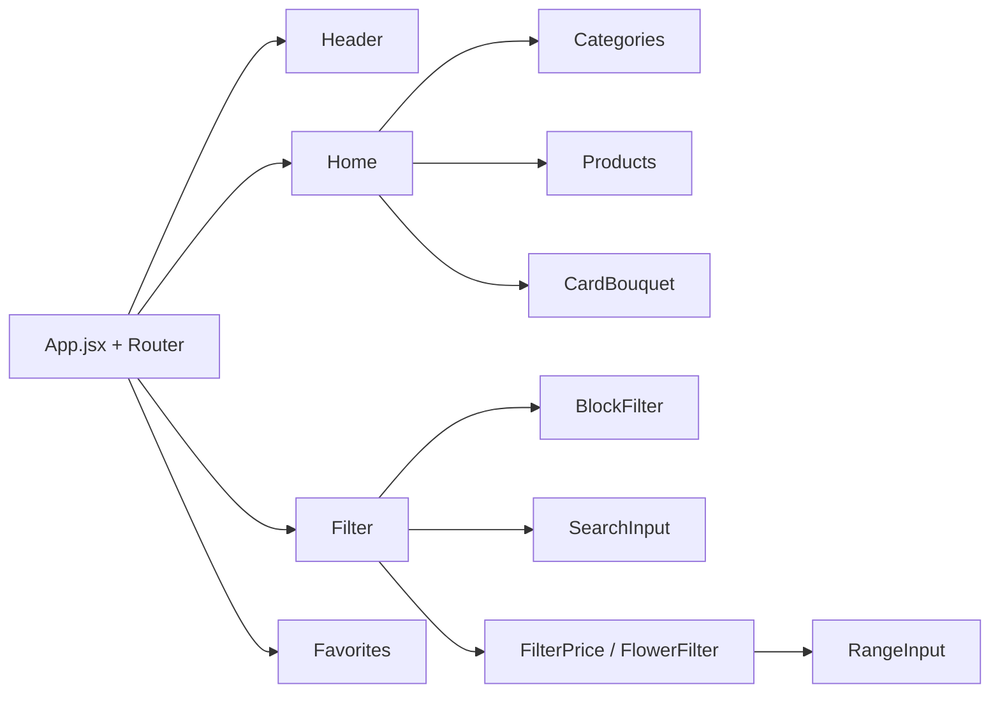

# Flower Shop

Интернет-магазин цветов и букетов: каталог с категориями, слайдеры, фильтры по цене и типу цветов, поиск и избранное.


## Страницы

| Путь | Что там |
|---|---|
| `/` | Главная: баннер, категории, популярные букеты |
| `/filter` | Каталог с фильтрами по цене и цветам, поиск |
| `/favorites` | Избранные товары |

## Архитектура



## Карта проекта

```
flower-shop/
└── src/
    ├── App.jsx                   # Роутинг
    ├── pages/
    │   ├── Home/                 # Главная
    │   ├── filter/               # Каталог с фильтрами
    │   └── favorites/            # Избранное
    ├── components/
    │   ├── Header/               # Шапка и навигация
    │   ├── Categories/           # Категории товаров
    │   ├── Products/             # Сетка товаров
    │   ├── CardProduct/, CardBouquet/   # Карточки
    │   ├── ButtonSlider/, ButtonShow/   # Кнопки слайдера и «показать ещё»
    │   ├── SearchInput/, InputFilter/, BlockFilter/
    │   ├── RangeInput/           # Двойной ползунок цены
    │   └── popups/               # Попапы фильтров: цена, цветы, категории
    ├── utils/                    # Общие функции
    └── assets/                   # Изображения
```

## Запуск

```bash
npm install
npm run dev
```
